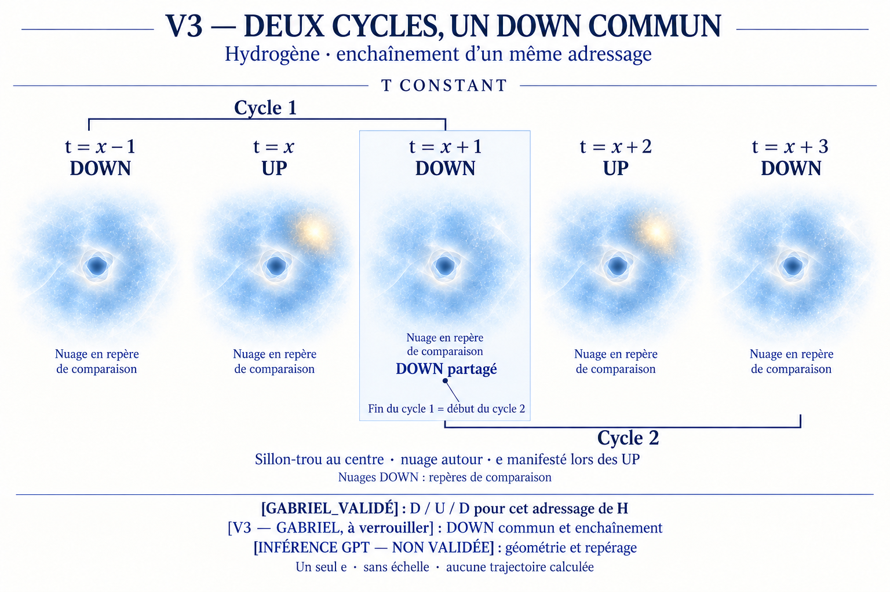
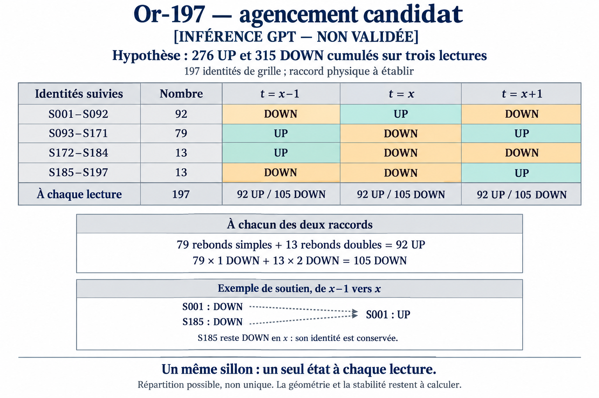
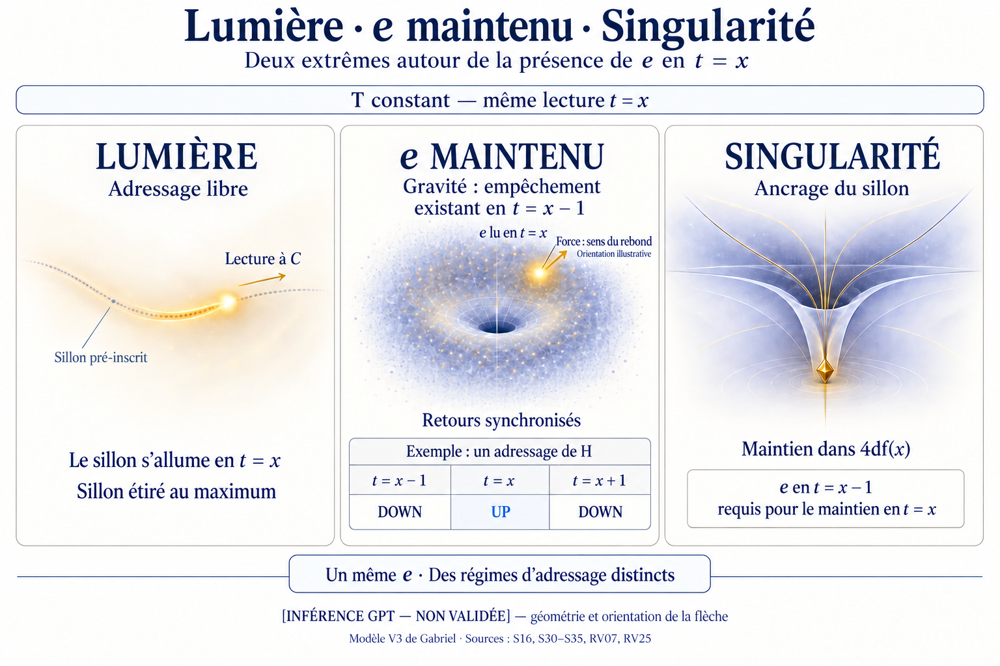

# Atlas visuel V3 — documentation et révision

**Dernier ajout : [or v03 — répartition candidate](03_OR_197_v03_REPARTITION_CANDIDATE.png).** Après la règle d'exclusion et de rebond [RV19](JOURNAL_REVISION_VISUELLE.md#rv19), une grille calculée conserve les identités et attribue un seul état par case. Statut : **[INFÉRENCE GPT — NON VALIDÉE]**, sous des hypothèses de cumul et de raccord explicites dans le [chapitre 11](../11_REPARTITION_ET_REBONDS_UP_DOWN.md). Les étapes antérieures ci-dessous restent disponibles.

**Ouverture : 10 septembre 2026.** Modèle : Gabriel Cantin. Conception des illustrations : GPT/Codex avec le générateur d'images intégré ImageGen.

Cet atlas sert à rendre notre compréhension visible et corrigeable. **La révision 04 superpose deux cycles d'un même adressage de l'hydrogène sur leur DOWN commun.** Elle reprend le cycle D/U/D confirmé en RV07 et la précision d'enchaînement RV09. Le sillon-trou central et le nuage autour restent schématiques. Les autres planches ci-dessous constituent un parcours proposé, encore à réaliser.

## Première planche, révision 04 — Deux cycles, un DOWN commun

[Ouvrir l'image actuelle](01_CYCLES_SUPERPOSES_v04.png) · [Lire les sources et les choix du dessin](01_NOTE_DE_LECTURE.md) · [Lire la précision d'enchaînement](JOURNAL_REVISION_VISUELLE.md#rv09) · [Consulter les prompts](PROMPTS_VISUELS_V3.md)

**[V3 — GABRIEL, à verrouiller]** La précision « des trou dans l'espace temps qui suivent les electron lors des up » remplace l'interprétation graphique en rainures. Elle rejoint le vocabulaire des « trous » de [S18](../sources/SESSION_GABRIEL.md#s18), sans définir leur géométrie ou leur loi de suivi.

**[GABRIEL_VALIDÉ]** La séquence pour cet adressage de H est DOWN en x−1, UP en x, DOWN en x+1 ([RV07](JOURNAL_REVISION_VISUELLE.md#rv07)). **[V3 — GABRIEL, à verrouiller]** Le nuage entoure le sillon-trou ([RV06](JOURNAL_REVISION_VISUELLE.md#rv06)). La manifestation UP est représentée à une position illustrative dans ce nuage.

**[V3 — GABRIEL, à verrouiller]** Le DOWN final est également le DOWN initial du cycle suivant ([RV09](JOURNAL_REVISION_VISUELLE.md#rv09)). La planche le dessine une seule fois, sous les deux crochets. Le repérage global proposé donne D/U/D/U/D ; les indices x+2 et x+3 ne sont pas des durées calculées.

Les contours, proportions, répétitions du nuage et position lumineuse sont des **[INFÉRENCE GPT — NON VALIDÉE]**. Dans les colonnes DOWN, le nuage sert de repère de comparaison ; il ne tranche pas la présence ou l'absence d'une manifestation. Aucune géométrie de 4df ni trajectoire électronique n'a été calculée. [V01](01_DU_SILLON_A_LOBSERVABLE_v01.png) conserve l'interprétation corrigée en rainures ; [v02](01_SILLONS_ET_UP_v02.png) conserve l'essai avec repère sur le bord, remplacé dans v03 par le nuage environnant.

## Discipline de lecture

| Statut | Usage dans l'atlas |
|---|---|
| [GABRIEL_VALIDÉ] | Proposition déjà validée par l'auteur dans la source citée ; validation interne au modèle. |
| [V3 — GABRIEL, à verrouiller] | Proposition directe de Gabriel dont la formulation ou le raccord restent à préciser. |
| [INFÉRENCE GPT — NON VALIDÉE] | Choix graphique, rapprochement ou formalisation proposé par GPT. |
| [OUVERT] | Question encore sans réponse ou règle mathématique manquante. |

Les sources historiques gardent leurs auteurs et leurs statuts. Approuver une illustration pour sa lisibilité ne valide pas ses mécanismes, ses équations éventuelles ni le modèle expérimentalement. Chaque correction conceptuelle sera conservée avec les mots de Gabriel et sa portée précise.

## Parcours proposé

**Deux nouvelles planches produites :** [hélium-4](02_HELIUM_4_v01.png), puis [or-197](03_OR_197_v02_MEME_IDENTITE.png), une image par atome. Le [cadrage et les notes de lecture](02_CADRAGE_HELIUM_OR_REPERE_COMMUN.md) distinguent les comptages externes, les identifiants dans les colonnes fixes et les lectures UP/DOWN encore ouvertes. Les figures n'imposent aucun décalage indépendant des cycles électroniques.

| Planche | Objet de la révision | Textes de départ | État |
|---|---|---|---|
| 01 — Deux cycles, un DOWN commun | Cycles D/U/D de H se recouvrant sur le DOWN de jonction | [RV07](JOURNAL_REVISION_VISUELLE.md#rv07), [RV09](JOURNAL_REVISION_VISUELLE.md#rv09), [01](../01_TERMINOLOGIE_T_REINDEXEE.md) | Révision 04 produite ; géométrie schématique |
| 02 — Hélium-4 | Quarks de valence 6u/6d ; identifiants dans les trois colonnes communes | [Image](02_HELIUM_4_v01.png), [note](02_CADRAGE_HELIUM_OR_REPERE_COMMUN.md) | Image produite ; lectures temporelles ouvertes |
| 03 — Or-197 | Même identité dans le temps ; UP/DOWN comme états ; nuages et proximité | [Image](03_OR_197_v02_MEME_IDENTITE.png), [note](02_CADRAGE_HELIUM_OR_REPERE_COMMUN.md) | Image produite ; lectures temporelles ouvertes |
| 04 — Deuxième perpendiculaire et adressage | Distinguer surface dans 4df et cycle lu à x ; représenter le changement d'adressage | [M02](../sources/SESSION_MATHEMATIQUES_CODEX.md#m02), [M03](../sources/SESSION_MATHEMATIQUES_CODEX.md#m03), [formalisation](../V3_4dfx_FORMALISATION_LEPTONS.md) | À construire ; comptage IN/OUT ouvert |
| 05 — Orbitales comme réponses | Distinguer les sorties recherchées et le catalogue externe n, l, m_l, m_s ; capacités et périodes | [03](../03_TABLEAU_PERIODIQUE_GEOMETRIE_V3.md), [04](../04_ORBITALES_COMME_REPONSES_4DF.md) | À construire ; aucune dérivation V3 acquise |
| 06 — Masse, rayon et cinétique | Séparer les propositions de Gabriel, les relations candidates et les résultats conditionnels de la première passe | [09](../09_VERBATIMS_ET_CONCLUSIONS_POUR_CALCUL.md), [formalisation](../V3_4dfx_FORMALISATION_LEPTONS.md) | À construire |
| 07 — Existence et désintégration | Préciser la différence x/x+1 évoquée par Gabriel sans inventer une durée de vie | [S64](../sources/SESSION_GABRIEL.md#s64), [07](../07_DETTES_ET_TESTS_ADVERSARIAUX.md) | À construire ; loi de transition ouverte |
| 08 — Collision, fusion et refusion | Illustrer l'hypothèse de réorganisation temporaire des sillons | [06](../06_ACCELERATEURS_FUSION_REFUSION_SILLONS.md) | À construire ; mécanisme quantitatif ouvert |

Les planches 02 et 03 sont disponibles pour la révision de Gabriel. Le travail sur la deuxième perpendiculaire reste au programme, sans l'assimiler à un deuxième IN/OUT indépendant. Les conventions graphiques et les lectures temporelles continueront d'être précisées séparément.

[Retour au dossier V3](../00_README_V3.md)

## Correction de l’or — même identité, deux états

La [version v02](03_OR_197_v02_MEME_IDENTITE.png) remplace les groupes séparés par une identité neutre S suivie dans x−1/x/x+1. UP et DOWN sont ses deux états possibles selon la [correction RV17](JOURNAL_REVISION_VISUELLE.md#rv17). Les couleurs de populations et les barres séparées de v01 sont retirées. Les états exacts par colonne restent [OUVERT]. La géométrie et S sont [INFÉRENCE GPT — NON VALIDÉE].

## Or v03 — même identité, états affectés et rebonds

[Calcul et limites](../11_REPARTITION_ET_REBONDS_UP_DOWN.md) · [Verbatim de Gabriel](JOURNAL_REVISION_VISUELLE.md#rv19) · [Prompt exact](PROMPTS_VISUELS_V3.md)

Cette grille remplit la fenêtre et compte les rebonds, sans déterminer une géométrie d'atome. Elle ne constitue pas une validation du pont entre lectures temporelles et inventaires de quarks de valence.

## Planche 09 — Lumière, e maintenu et singularité

[Ouvrir l'image](09_LUMIERE_E_SINGULARITE_v02_GRAVITE_REBOND.png) · [Sources et portée](../13_LUMIERE_SINGULARITE_ET_PRESENCE_DE_E.md) · [Demande de Gabriel](JOURNAL_REVISION_VISUELLE.md#rv23) · [Prompts](PROMPTS_VISUELS_V3.md)

**[INFÉRENCE GPT — NON VALIDÉE]** Mise en regard et géométrie ; les trois panneaux ne sont pas trois positions temporelles. La miniature DUD est limitée à l'adressage H confirmé. Le panneau singularité conserve la condition de maintien S30. Aucun opérateur d'opposition ou vitesse de singularité n'est déduit.

## Planche 09, révision 02 — Empêchement et sens du rebond

La [version courante](09_LUMIERE_E_SINGULARITE_v02_GRAVITE_REBOND.png) intègre [RV25](JOURNAL_REVISION_VISUELLE.md#rv25) : gravité comme empêchement en x−1, force du e maintenu dans le sens du rebond. Une flèche locale illustre cette orientation près de la manifestation. Le sens vers le haut et la droite est un choix de dessin, indiqué sur l'image.

[V01](09_LUMIERE_E_SINGULARITE_v01.png) reste l'étape antérieure. [Sources, formulation et limites](../13_LUMIERE_SINGULARITE_ET_PRESENCE_DE_E.md#gravite-rebond) · [Prompt exact](PROMPTS_VISUELS_V3.md).
